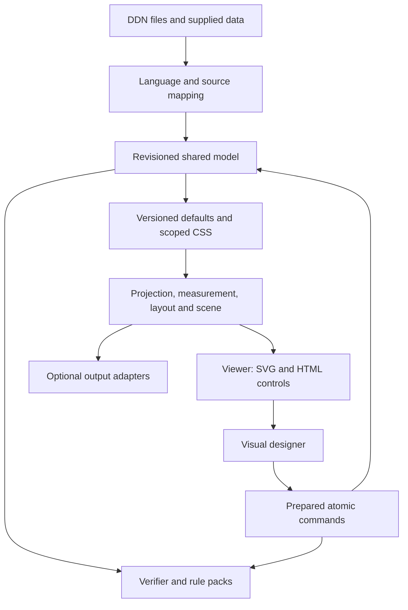

# Shared architecture

## Public utilities and shared services

Three public modules expose stable APIs: `ddn-viewer`, `ddn-visual-designer` and `ddn-verifier`. A visual designer instance composes an existing viewer instance. It must not create a second renderer, parser or competing model. A verifier can run without the viewer, designer, DOM, canvas, font loading or a browser UI.

The internal services are separately testable modules. Modules are boundaries for dependencies and ownership, not a requirement to ship dozens of HTTP requests.

| Service | Owns | Excludes |
|---|---|---|
| Language | Indentation-aware tokens, lossless concrete syntax, decoding, sparse encoding, source spans and file-local names | Rendering and tool UI |
| Model | Immutable revision snapshots, qualified identities, reference/dependency indexes and atomic commit receipts | DOM and algorithm execution |
| Defaults | Compiled versioned codex, scope matching, CSS-eligible settings, resolved values with provenance | Semantic facts inferred from appearance |
| Verification | Rule execution, dependency coverage, diagnostics and review eligibility | Status changes, source repair and layout as proof of validity |
| Presentation | Selection/projection, text layout, geometric scene, layouts, routes and publication composition | File writes and source ownership |
| Execution | Jobs, cancellation, priorities, worker transport and bounded cooperative fallback | Diagram semantics |
| Viewer | Visible scene realization, navigation, inspection and accessible controls | Editing commands |
| Designer | Edit intents, drafts, command preparation, transactions and undo/redo | Independent copies of verification or drawing logic |
| IO and output adapters | Selected files, snapshots, downloads and explicit output formats | Implicit remote access, mandatory server or automatic delivery |

Expensive language, verification, projection and geometry work runs through the execution service. Its location does not change the result or the API. UI and actual DOM measurement stay in the browser's main context. Installed profile algorithms have no direct access to the source store or DOM.

## One runtime per host context

`createRuntime()` constructs an explicit registry, source/model store, dependency index, caches and scheduler. Consumers may mount several viewers on that runtime; each has its own camera, viewport, selection and occurrence presentation. Hosts needing isolation create a second runtime. No process-global “first module wins” registry is permitted. An optional custom element is a wrapper over the same API, not another runtime.

Runtime version, language/defaults version, utility API version and profile version are separate values. Compatibility is checked before a pack is registered. Unsupported versions produce a capability diagnostic. Loading another utility must not replace the first instance's registry or rules. Destruction unregisters subscriptions and releases instance-owned jobs, object URLs, DOM and caches; one viewer's destruction must not destroy a shared runtime used by another.

## Source and semantic model

Original file bytes and a lossless syntax tree remain available so visual changes can preserve comments, quote choices, omitted values and unrelated formatting. The semantic model is a derived, immutable revision snapshot indexed by `(sourceFile, stableId)` with file-local declared names. It follows the codex's one-active-workarea and include rules. In-memory tables/indexes use references to records rather than copying the full model into each view.

A source-file revision, semantic snapshot revision and derived presentation generation are distinguishable. A comment change advances the source revision; unchanged semantic dependencies retain their semantic fingerprint and geometric cache entries. A change of font or viewport advances presentation state without fabricating a semantic revision. Hashes include normalized inputs and applicable version identities; caches cannot be keyed by a view name alone.

Parsing can begin incrementally at the changed line/block. In indentation-sensitive text, reparse through a stable indentation/token boundary; if stability cannot be proved, reparse that file. A source edit is allowed to be incomplete while typing. The source buffer and diagnostics remain available, while the last valid dependent scene is visibly marked as belonging to an earlier revision. No binding is guessed from broken syntax. Unaffected files/views remain usable.

A raw source edit and a visual edit share the transaction boundary. A visual command produces source edits plus the corresponding typed semantic delta and a read/write set. Before commit, validate against the same base revision. The model service atomically applies a prepared command only if that base and its verified preconditions still match. The receipt advances the revision once and makes source/model changes visible together. Do not mutate the model and hope to serialize it later.

## Dependency driven computation

Indexes record definition-to-appearance use, membership, relation endpoints, data bindings, style matches, profile rules and publication inclusion. A change invalidates its dependency closure. Every rule and presentation stage declares input paths and dynamically observed references. If a pack cannot provide a safe dependency set, invalidate its containing scope; never reuse a result whose inputs might have changed.

| Change | Required work | Preserved work |
|---|---|---|
| Pan or zoom | Camera transform, visible set, pointer mapping and accessible focus | Parse, semantic verification and stable layout |
| Pure color or opacity | Resolved paint and affected scene attributes | Text measurement and routing, unless a registered rule explicitly depends on it |
| Text or font | Matching text runs, affected box sizes and dependent layout/routes | Unrelated files, views and verification rules |
| One structured data cell | Bound projections/rules and dependent visual marks | Unrelated datasets and their views |
| Relation endpoint | Endpoint/reference checks and that relation's layout dependency closure | Unrelated profile packs and independent views |
| Shared domain | All dependent field rules and appearances | Other domains and unreferencing views |
| Status command | Lifecycle eligibility, scope evidence and badge | Diagram geometry unless the badge changes measured composition |
| Source comment | Syntax/source-map offsets and source fingerprint | Semantically unchanged rule/projection/layout results |

A local change can legitimately require global work within one view: tree roots, graph cycles, routing obstacles, chart normalization and scale domains are examples. The pack declares that dependency. “Incremental” does not mean rerouting just one edge when every obstacle changed. Local interactive previews may be provisional; committed scenes must satisfy the full selected contract.

## Scene contract and initial renderer

A geometric scene is the renderer-independent result of projection, measurement, layout and routing. Each item records its stable occurrence key, semantic target, owning view, layer, bounds, transform, typed drawing primitives, text runs, hit targets, accessibility description and diagnostic/status decorations. Definition and appearance identity remain separate. A field endpoint still maps to its field when the field's rows are hidden or wrapped.

Initial interactive rendering uses **SVG**, with keyed scene patches instead of replacing the entire SVG string on every edit. The viewer mounts only visible views/items plus an overscan margin. Connections crossing the viewport remain visible even when their endpoints are off-screen. Hit testing uses scene geometry and a spatial index; editor logic cannot depend on DOM child order or SVG selectors.

HTML provides toolbars, inspectors, menus, tables used as editors, native text inputs and the keyboard/assistive navigation surface. Editing text uses positioned HTML inputs/textareas; it does not require `foreignObject`. The accessible semantic outline is derived from the model, not restricted to mounted SVG nodes.

Use level of detail to omit unreadable visual detail at distant zoom while retaining type/status signals and inspection access. Culling/level of detail never changes verification scope or publication content. A table that cannot satisfy its codex constraints uses the specified shaded-square indicator; this is separate from ordinary zoom simplification.

Canvas 2D remains an optional scene backend for measured dense-data cases. Do not ship two complete general-purpose renderers in the minimum viewer. A Canvas backend must supply equivalent hit targets, accessible navigation and consistent export semantics. WebGL/WebGPU and a full WebAssembly engine are deferred until profiling identifies a specific justified need.

## Text and styles

Resolve file > CSS > standard through the same defaults service for SVG, preview, publication and the inspector. A font change, including eligible CSS, invalidates measurement; do not apply an arbitrary CSS font-size change to SVG while leaving its box geometry untouched. Selector scope includes method, subtype/profile, role, owner/category, source file and classes as admitted by the codex.

Text measurement is cached by font identity/content hash, family, size, weight, style, language/direction and text. Wait for the selected font to be ready or use the codex's explicit fallback with provenance. A worker receives measured runs and a font-generation token. A new font invalidates matching metrics; no silent permanent downgrade to blocking whole-document rendering is allowed.

The source text/Markdown representation is distinct from shaped/wrapped runs. Default-font character/line units, the table percentage algorithm and ellipsis are applied before generating primitives. Do not use a separate word-wrap algorithm for exports. Determinism means identical semantic results and scene plans for the same explicit metrics/seed/versions; it is not a promise of byte-identical font rasterization across operating systems.

## Jobs and worker protocol

Use one lazily started compute worker per runtime by default, shared by viewer, designer and verifier. Starting one worker for every view or utility duplicates too much memory. The authoritative committed source/model snapshot and recovery state remain controlled by the main runtime; the compute worker holds a derived replica, initially synchronized and then updated by deltas. Initial synchronization cost is measured separately from steady-state edits.

Messages include protocol version, runtime/session ID, job ID, base revision, dependency fingerprint, profile/pack versions, font/style generation, job kind, limits and payload. Results carry the same identifiers plus coverage and timing. Apply a result only if the relevant identifiers still match. Scene patches are atomic for a visible coherent revision; retain the old scene with a pending/stale marker until a complete applicable patch is ready.

Requests are ordered by intent: pointer feedback uses local preview state; selected-view updates outrank thumbnails and prefetch. Bulk export/verification uses lower priority. Repeated live-data replacements coalesce to the latest coherent revision; keyed deltas must be composed or replaced by a supplied authoritative snapshot, never dropped arbitrarily.

Cancellation is cooperative within bounded work slices and also supports worker termination. A worker must yield to its message queue so it can observe cancellation. If a job ignores cancellation past 100 ms, terminate its worker, reject its pending jobs exactly once, restart lazily and rehydrate from the last committed snapshot. A stale Promise rejection without stopping obsolete CPU work is insufficient. A worker crash cannot lose committed or uncommitted user source text.

No-worker execution uses the same algorithms with cooperative slices, targeting at most 4 ms of scheduled main-thread computation per slice. Detect `scheduler.yield` where available, with a task-based fallback; do not depend on it for correctness. Long non-cooperative algorithms must stop at a declared budget, not silently block the UI for seconds. Workers, OffscreenCanvas, SharedArrayBuffer, cross-origin isolation and service workers are not prerequisites for baseline offline operation.

## Closed expansion seam

Open utilities accept host-supplied revisioned data, resources, capabilities and optional region providers. The open local provider can serve a workarea larger than the viewport without a server. A commercial provider can supply paged subsets and server-computed scene/rule results through the same versioned interfaces, tagged with coverage and provenance.

The closed extension owns collaboration, identity federation, concurrent merge policy, presence, sessions, authoritative permissions, server rendering and managed delivery. The standard utilities do not include CRDT/OT engines, voice/video clients or deployment executors. Supplied remote results cannot turn a partial local check into a complete verification result, and receiving updates does not grant viewer editing rights.
